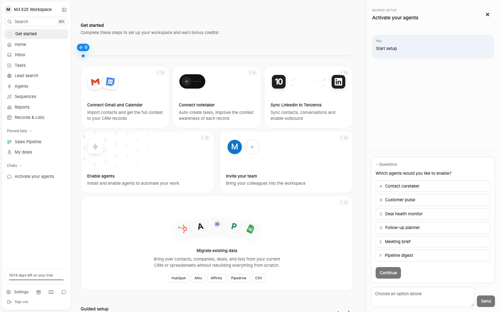

# Tenzeros

A clean-room rebuild of an AI CRM onboarding experience, built with Nuxt 4, Vue 3.5, strict TypeScript, Drizzle/SQLite, and DeepSeek. See [PLAN.md](PLAN.md) for the milestone boundaries.

## Setup

Requires Node.js **22.12+** (verified on Node 24) and **pnpm 10**. `better-sqlite3` uses a native module; platforms without a prebuilt binary need a compiler toolchain.

```sh
pnpm install
cp .env.example .env # Skip this if .env already exists.
# Set DEEPSEEK_API_KEY in .env. Never commit this file.
pnpm db:migrate
pnpm db:seed        # Optional: creates the demo account, without an LLM call.
pnpm dev
```

Open `http://localhost:3000/signup`. Enter your name, email, workspace name, and company domain. Signup creates an admin workspace with a 14-day trial and 2,000 top-up credits, then immediately opens `/:workspace/onboarding` while AI context is generated in the background. Find the four editable contexts under **Settings → AI context**.

The optional seed is idempotent. Sign in at `/login` with **Demo User** and **demo@tenzeros.local**; the workspace is `/demo-workspace/onboarding`. To generate its contexts, open Settings → AI context and select **Restart if interrupted**. The seed itself makes no network requests.

**Local demo authentication:** v1 intentionally accepts a matching name and email without a password or email verification, as specified in the plan. It is not an identity verification system. Sessions are encrypted, HttpOnly, SameSite=Lax cookies, valid for seven days; production uses Secure cookies.

## Environment

| Variable              | Purpose                                                                                                                                                                        |
| --------------------- | ------------------------------------------------------------------------------------------------------------------------------------------------------------------------------ |
| `DEEPSEEK_API_KEY`    | Real DeepSeek key; only read on the server. Missing keys produce clear, retryable context/chat errors.                                                                         |
| `DEEPSEEK_BASE_URL`   | Defaults to `https://api.deepseek.com`.                                                                                                                                        |
| `DEEPSEEK_MODEL`      | Defaults to `deepseek-chat`.                                                                                                                                                   |
| `LLM_MOCK`            | `1` enables deterministic text, JSON, and tool-call responses without LLM network requests. Default `0`. Homepage fetching still runs, with its safety limits.                 |
| `NUXT_SESSION_SECRET` | At least 32 characters. `.env.example` includes a development-only default; replace it with `openssl rand -hex 32` for production. Production rejects the development default. |

Nuxt reads `.env` during development. The LLM adapter resolves `DEEPSEEK_*` and `LLM_MOCK` into a server-only runtime-config snapshot, so secrets are not baked into a build or exposed through `runtimeConfig.public`. Nuxt's `NUXT_DEEPSEEK_*` overrides also work; the unprefixed names take precedence.

## Commands and verification

```sh
pnpm typecheck   # Nuxt app/server plus scripts and tests, all strict
pnpm test        # Vitest unit and HTTP API tests; in-memory SQLite + LLM_MOCK=1
pnpm build       # Production Node server
pnpm db:generate # Generate SQL after a schema change; review and commit it
pnpm db:migrate  # Apply committed migrations to .data/tenzeros.db
pnpm db:seed     # Optional demo account
```

For a local production smoke test, set a non-default `NUXT_SESSION_SECRET`, then run `pnpm preview` after building. This loads `.env` with Node's `--env-file`; use HTTPS when accessing production session routes because their cookies are Secure. For deployment, run `node .output/server/index.mjs` with environment variables supplied by your host. Run migrations from the repository root first and keep the `.data/` volume persistent. The app uses a single Node process and a local SQLite file; the SSE hub and job queue are in-memory.

Tests cover transactional signup, unique slugs, session cookies, workspace authorization, editable contexts, scoped SSE (including an actual HTTP stream), context bootstrap and retries, deterministic LLM text/tool streaming, and homepage SSRF defenses, redirects, byte limits, and timeouts. Tests never read the real `.env` or call DeepSeek.

## M1 scope and extension points

- Self-hosted Inter, Tabler icons, and independently retyped CSS tokens; no Tailwind or Zero assets.
- Sidebar with workspace switching, a command-palette stub (`⌘K` / `Ctrl+K`), pinned lists, Chats, a computed trial pill, settings/footer links, collapse, mouse/touch/keyboard resizing, and the sidebar dismiss confirmation. Dismissal persists per membership and, for admins, the workspace.
- All 26 tables from PLAN §2, foreign keys, uniqueness constraints, migrations, and the demo seed. `listEntries.entityId` is deliberately polymorphic; future domain tools must validate its entity type and workspace. Membership onboarding timestamps support the shell dismissal semantics from the spec. `workspaces.contextStatus/contextError` expose asynchronous generation state and allow retry after interruption.
- `server/utils/llm.ts` is the only LLM SDK entry point. `chat()` returns content/tool calls; `streamChat()` yields SDK-shaped text/tool-call deltas. Provider failures are sanitized typed `LLMError`s.
- The homepage fetch has an 8-second total deadline, validates all DNS addresses and redirects, pins sockets to validated public IPs, retains the first 1.5 MB of large responses, prepends title/description/Open Graph metadata, excludes scripts and hidden markup, and passes at most 12,000 characters as untrusted evidence. Truncated scripts cannot consume the visible-text budget. Generation hedges uncertain claims and labels hypothetical customers.
- Authenticated `GET /api/stream` publishes row changes through `emitChange(workspaceId, model, op, row)` and custom events through `emitCustomEvent()`. Membership access is rechecked per event. Streams heartbeat and reconnect periodically; `useRealtime()` shares one EventSource, reconnects natively, and offers `onConnected` for a fresh snapshot. The context page coalesces connection and bootstrap events into one refresh per burst, with a trailing refresh for events received during an in-flight request. There is no event replay log or multi-process broadcast in M1.
- Bootstrap jobs run in-process via Nitro `event.waitUntil`. Interrupted jobs can be restarted from the context page. A ready workspace is not regenerated, so retries do not overwrite edited context.
- M2 adds the onboarding page and domain actions described below. AI chat, agent execution, CSV mapping, and guided-flow execution remain M3 work; the wider hardening suite remains M4.

`research/`, `.env`, `.data/`, dependencies, and build output are gitignored. The implementation uses the behavior/layout references without copying the original source, assets, or fonts.

## M2: onboarding

Open a fresh workspace at `/signup`, or sign in and visit `/:workspace/onboarding`.

- The six task cards connect Gmail/Calendar, a notetaker, and LinkedIn; enable an agent; invite teammates; and migrate demo CRM data. Workspace tasks are visible only to admins until workspace onboarding is completed or dismissed.
- Each **Simulate connection** flow is labelled **Demo**. Gmail creates both mailbox and calendar rows. The notetaker picker offers all eight providers. Invitations create pending memberships without sending email. CRM imports create 10 fictional companies and 10 contacts, labelled `(Demo)`, with `isExample: true` and `attributes.source: 'demo'`. View them under **Records & Lists**.
- The six ready-made agents are seeded on the first admin visit to **Agents**. Toggles persist; background agent execution is outside this onboarding milestone. Enabling the first agent completes the onboarding task.
- `server/utils/onboarding.ts` owns qualifying writes, completion inserts, and credit accounting. Its immediate SQLite transaction uses the existing partial unique indexes for idempotency. A transaction-local event queue publishes SSE **after commit**, so rollback cannot leak a phantom completion. Personal tasks award 25 credits to the first four users per task per workspace; subsequent users and legacy workspaces get zero. Workspace tasks award 25 once. Dismissed tasks cannot earn previously unclaimed credits.
- The UI reconciles SSE changes without polling. The spring progress bar switches to task counts when any reward is zero. Browser storage remembers started onboarding and celebrated tasks. Completing all visible tasks enables **Complete onboarding**; the server validates completion before persisting timestamps and returning home.
- Guided setup shows six cards, stable status ordering, mailbox locks, and overflow controls. Cards now open the M3 docked chat; CSV opens the import assistant.

### Optional real Google connection

Set **both** `GOOGLE_CLIENT_ID` and `GOOGLE_CLIENT_SECRET` in the server environment to show **Connect Google Account** alongside the demo button. Configure a Google web OAuth client with the exact redirect URI `http://localhost:3000/api/integrations/google/callback` (or the origin you use, including port). Enable Gmail and Calendar APIs and add your demo sign-in email as a test user in the Google consent configuration.

The flow follows [Google's web-server OAuth protocol](https://developers.google.com/identity/protocols/oauth2/web-server), requests read-only mail/calendar scopes plus identity, uses expiring session-bound state and PKCE, and requires the selected Google email to match the signed-in email. Tokens are AES-256-GCM encrypted in connection settings using a key derived from the client secret; rotating that secret requires reconnecting accounts. Credentials are excluded from public snapshots and SSE. This milestone connects the account but does not implement mail/calendar ingestion or token refresh workers.

### Screenshots and verification

```sh
pnpm exec playwright install chromium
LLM_MOCK=1 pnpm dev --host 127.0.0.1 --port 3000
# In another terminal:
pnpm test:screenshots
# Optional: PLAYWRIGHT_BASE_URL=http://127.0.0.1:3001 pnpm test:screenshots
```

The script creates a new demo workspace, completes all six tasks through the UI, checks 150 bonus credits, storage persistence, gallery locks, mobile/tablet overflow, and the final redirect. It saves fresh and completed **1200×852** screenshots plus a full-page completed screenshot under `docs/screenshots/`. Use a mock-enabled server to avoid LLM calls. Vitest also covers reward scoping, idempotency, rollback and SSE, authorization, input validation, invitation uniqueness, imports, and mocked Google OAuth.

The UI uses original CSS/SVG illustrations and CC0 Simple Icons where available. Attio, Affinity CRM, and Pipedrive use text/generic symbols because those logos are absent from the pinned icon catalogue; LinkedIn is available in Simple Icons v11. The consent preview is an original illustration. All product naming and the credit glyph are Tenzeros-specific.

## M3 chat and guided setup

Click a guided setup card to open its chat on the right. The assistant speaks first; answer the pinned controls or use the composer for free-text questions. Resume uses the same persisted chat, including unanswered controls. **Start from beginning** creates a new chat and resets the flow status, retaining earlier chats as read-only history. Outreach and writing style require your connected mailbox; the **Simulate connection** option unlocks them for local testing. No email or LinkedIn message is sent, and writing style uses 2–3 pasted samples rather than reading mail.

Pipeline stages and every outreach draft are shown for approval before the exact approved payload is written. Target accounts receive a DeepSeek-generated fit score and rationale. With no company records, the assistant offers up to ten fictional **Example** accounts. The Customers list is curated; automatic list membership and background agent execution are not implemented.

The CSV tile opens **Import your data**. Upload a UTF-8 `.csv` up to 5 MB (up to 100 columns, 20,000 characters per cell), review the proposed mapping, then confirm. DeepSeek receives only headers and the first five rows, alongside workspace context. All rows import in one transaction; formula-like cells are prefixed with an apostrophe for safe text storage. Imported source rows are removed after completion. CSV is supported in M3; Excel is not advertised or accepted. Imports create records rather than deduplicating existing CRM records.

All LLM requests go through `server/utils/llm.ts`. Flow prompts are server-only. Workspace context, records, homepage evidence, samples and CSV data are delimited untrusted JSON. Zod validates tool arguments, workspace ownership is rechecked, and the tool loop stops after eight rounds per turn. Controls, completion, errors and chat history survive reloads. Flow HTTP/SSE status values are `unstarted`, `active`, `completed`; the database retains the existing M1 status enum through an adapter. Chat turns and uploads serialize per chat in the single-process runtime.

### M3 verification

```sh
pnpm install
pnpm format:check
pnpm typecheck
pnpm test
# Stop your development server before building (Nuxt protects its build directory).
pnpm build
pnpm exec playwright install chromium
pnpm test:e2e
```

Playwright starts a mock server on port 3100 with a separate build directory. It verifies the signup/login forms with JavaScript disabled and runs the agents walkthrough through selection, refresh/resume, completion and restart. `CAPTURE_CHAT_SCREENSHOT=1 pnpm test:e2e` also updates `docs/screenshots/m3-docked-chat.png`. Vitest scripts provider responses per async test context using `withMockScript`, including errors and multi-round tool sequences.

To run the six walkthroughs plus CSV against real DeepSeek:

```sh
LLM_MOCK=0 pnpm dev --host 127.0.0.1 --port 3001
# In another terminal, with the dev server loading the existing .env:
VERIFY_BASE_URL=http://127.0.0.1:3001 pnpm verify:real
```

This creates a new Stripe-domain test workspace, waits for real AI contexts, adds a demo mailbox, answers each control using test fixtures, and verifies completed statuses. It writes local transcripts and the test account identity to `/tmp/tenzeros-m3-real-transcripts.json` and `/tmp/tenzeros-m3-verification-account.json`. `VERIFY_REUSE=1` reuses that test account for another pass. Keep the dev server stable during verification; hot reloads can interrupt provider requests. Real requests consume provider credits. The verification on 2026-10-22 completed all seven flows; transcript excerpts are in the M3 PR.


